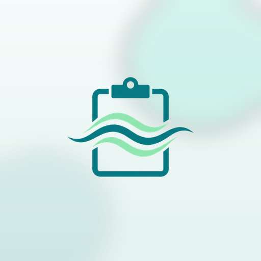

<p align="center">
  
</p>

<h1 align="center">Clipboard River</h1>

<p align="center">
  <a href="README.md">English</a> | <a href="README.zh-CN.md">简体中文</a>
</p>

<p align="center">
  An Android clipboard sync client built around foreground-triggered actions,
  focused on reliable text capture, short-lived realtime receive sessions,
  local history retention, and Android-friendly image sharing.
</p>

## Why this app uses a pinned notification

Modern Android treats clipboard access as a foreground interaction. Background apps cannot reliably read clipboard contents the way desktop apps do, and trying to keep a permanent background clipboard sync loop leads to inconsistent behavior, aggressive process kills, and a poor user experience.

Clipboard River Android therefore uses a pinned notification in the status bar / notification shade:

- `Capture content`: opens a compact overlay, brings the app into an allowed foreground context, then reads the current clipboard once.
- `Receive content`: opens a compact overlay and starts a short-lived foreground WebSocket session for remote receive.

This design exists mainly because of Android clipboard restrictions:

- Clipboard access is most reliable when the app is foregrounded by explicit user action.
- Android does not provide a good desktop-style "always watch clipboard in background" model for third-party apps.
- Foreground-only receive sessions are more predictable on mobile devices with frequent background process limits and network suspension.
- A small overlay is less disruptive than launching a full-screen activity every time.

In short: the pinned notification is not a cosmetic choice. It is the practical way to make clipboard sync behave well on Android.

## Current capabilities

- On-demand text capture from the system clipboard
- Foreground realtime receive for remote text items
- Image import through Android share sheet
- Remote image download to `Pictures/ClipboardRiver`
- Local history for manually captured text and shared images
- Pending queue and manual history upload
- Wi-Fi-only rule for history sync
- English and Simplified Chinese UI
- Compact overlay actions from both the main screen and the pinned notification

## Content behavior

| Source | Behavior | Stored in local history |
| --- | --- | --- |
| Manual text capture | Reads clipboard once, optionally uploads immediately | Yes |
| Shared image into app | Imports image file, optionally uploads immediately | Yes |
| Remote text receive | Writes text to system clipboard immediately | No |
| Remote image receive | Downloads image and saves it to `Pictures/ClipboardRiver` | No |

Notes:

- Local history is the history of local manual actions.
- Remote receive is intentionally not added to local history.
- Android image copy/paste is not treated like desktop clipboard images. Image sending uses Android's share flow instead of clipboard monitoring.

## Main screens

- `Overview`: registration, connection status, quick actions, reconnect
- `History`: local records, pending upload count, manual history upload
- `Settings`: server URL, device nickname, sync toggles, retention policy, text length rules, Wi-Fi-only history sync

History long-press actions:

- Text item: `Copy` or `Delete`
- Image item: `Open image` or `Delete`

## Sync model

- The app starts a pinned notification after launch.
- `Capture content` can work even before registration:
  - save locally if local history is enabled
  - upload immediately only if the device is registered and `Send sync` is enabled
- `Receive content` requires registration and `Realtime receive` enabled.
- Main screen realtime receive only stays connected while the app is in foreground.
- Overlay receive sessions also connect only while that overlay is active.
- Reconnect is limited to the active foreground session. There is no infinite background reconnect loop.

## Local storage

- App config: `DataStore`
- Device token: `EncryptedSharedPreferences`
- Local history: `SQLiteOpenHelper`-based repository
- Shared image history files: `Android/data/<package>/files/history_images`
- Remote received images: `Pictures/ClipboardRiver`

## Tech stack

- Kotlin
- Jetpack Compose
- Coroutines / Flow
- DataStore
- EncryptedSharedPreferences
- OkHttp
- kotlinx.serialization
- Manual `AppContainer` dependency wiring

## Project structure

- `MainActivity`: main tabs and app-level UI
- `ActionNotificationService`: pinned notification and overlay action panel
- `NotificationActionActivity` / `NotificationCaptureActivity` / `ShareImageActivity`: lightweight bridge activities for notification/share flows
- `SyncCoordinator`: registration, upload, settings update, history flush
- `CaptureCoordinator`: one-shot local capture flow
- `ReceiveCoordinator`: remote receive flow
- `RealtimeSessionManager`: WebSocket ownership and foreground reconnect behavior
- `HistoryRepository`: local history and runtime state storage
- `ConfigRepository`: user settings and server capability storage
- `ApiClient`: HTTP / WebSocket API access

## Requirements

- Android 12L or newer (`minSdk 32`)
- JDK 17
- Recent Android Studio
- A compatible Clipboard River server

## Build

### Android Studio

1. Open this folder in Android Studio.
2. Let Gradle sync.
3. Run the `app` configuration on a device or emulator.

### Command line

```bash
./gradlew assembleDebug
```

## Permissions

- `POST_NOTIFICATIONS`: shows the pinned action notification
- `SYSTEM_ALERT_WINDOW`: displays the compact action overlay
- `INTERNET` / `ACCESS_NETWORK_STATE`: server communication and network checks

## Current limitations

- No boot-time automatic restore of the pinned notification. After device reboot, open the app once to restore it.
- No background infinite reconnect.
- No desktop-style background clipboard polling.
- Image send is based on Android share intents, not clipboard image monitoring.
- Cleartext HTTP is currently allowed to support local/test server deployments.
