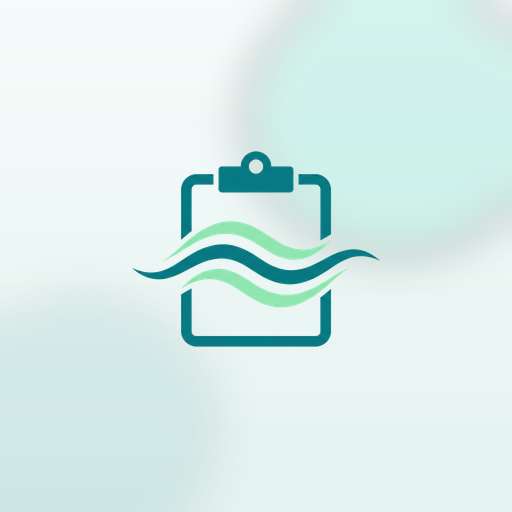

<p align="center">
  
</p>

<h1 align="center">Clipboard River</h1>

<p align="center">
  <a href="README.md">English</a> | <a href="README.zh-CN.md">简体中文</a>
</p>

<p align="center">
  一个面向 Android 的剪贴板同步客户端，采用前台触发式交互，
  重点解决文本记录、短会话实时接收、本地历史保留，以及更符合移动端习惯的图片分享流程。
</p>

## 为什么要用常驻通知栏入口

现代 Android 对剪贴板访问限制很多。第三方应用很难像桌面软件一样在后台稳定读取剪贴板内容；如果强行做后台实时监听，往往会遇到权限限制、进程被系统杀掉、网络挂起、行为不稳定等问题。

所以 Clipboard River Android 采用了“状态栏常驻通知 + 小型悬浮操作窗”的方案：

- `记录内容`：点击后打开一个紧凑悬浮窗，把应用带到可访问剪贴板的前台上下文里，然后只读取当前剪贴板一次。
- `接收内容`：点击后打开一个紧凑悬浮窗，并启动一个短时前台 WebSocket 会话，用来接收远端内容。

这个方案的核心原因就是 Android 的剪贴板限制：

- 只有在用户显式触发、应用处于前台时，访问剪贴板才最可靠。
- Android 不适合第三方应用长期在后台做“桌面式”的实时剪贴板守护。
- 移动端后台限制和断网场景很多，前台短会话比后台无限重连更稳定。
- 用一个小悬浮窗，比每次都拉起整页界面更不打扰用户。

简单说，常驻通知栏不是为了“看起来方便”，而是为了在 Android 上把剪贴板同步做得更可靠。

## 当前能力

- 按需读取系统剪贴板中的文本
- 前台实时接收远端文本
- 通过 Android 分享面板导入图片
- 接收远端图片并保存到 `Pictures/ClipboardRiver`
- 保存本地历史
- 待上传队列与手动上传历史
- 支持“仅 Wi-Fi 下同步历史”
- 支持英文 / 简体中文界面
- 可从主页或常驻通知栏打开紧凑悬浮操作窗

## 内容处理规则

| 来源 | 行为 | 是否进入本地历史 |
| --- | --- | --- |
| 手动记录文本 | 读取一次当前剪贴板，可选实时上传 | 是 |
| 分享图片到本应用 | 导入图片文件，可选实时上传 | 是 |
| 接收远端文本 | 立即写入系统剪贴板 | 否 |
| 接收远端图片 | 下载并保存到 `Pictures/ClipboardRiver` | 否 |

补充说明：

- “本地历史”定义上就是本机手动产生的记录。
- 所有远端接收内容都不会写进本地历史。
- Android 上图片复制/粘贴和桌面端不是一回事，所以图片发送走分享流程，不走剪贴板图片监听。

## 主要页面

- `概览`：注册、连接状态、快捷操作、重新连接
- `历史`：本地记录、待上传数量、手动上传历史
- `设置`：服务器地址、设备昵称、同步开关、保留策略、文本长度规则、仅 Wi-Fi 下同步历史

历史记录长按后的操作：

- 文本记录：`复制` / `删除`
- 图片记录：`打开图片` / `删除`

## 同步模型

- 应用启动后会恢复常驻通知。
- `记录内容` 在未注册时也可以使用：
  - 如果开启了本地历史，就先保存到本地
  - 只有在设备已注册且开启 `发送同步` 时才会立即上传
- `接收内容` 需要设备已注册，并且已开启 `实时接收`
- 主页面的实时接收只在应用处于前台时保持连接
- 悬浮窗接收会话也只在悬浮窗存活期间连接
- 重连只发生在当前前台会话里，不做后台无限重连

## 本地存储

- 应用配置：`DataStore`
- 设备令牌：`EncryptedSharedPreferences`
- 本地历史：基于 `SQLiteOpenHelper` 的 `HistoryRepository`
- 分享导入的历史图片：`Android/data/<包名>/files/history_images`
- 远端接收的图片：`Pictures/ClipboardRiver`

## 技术栈

- Kotlin
- Jetpack Compose
- Coroutines / Flow
- DataStore
- EncryptedSharedPreferences
- OkHttp
- kotlinx.serialization
- 手写 `AppContainer` 依赖装配

## 项目结构

- `MainActivity`：主界面与底部导航
- `ActionNotificationService`：常驻通知与悬浮操作窗
- `NotificationActionActivity` / `NotificationCaptureActivity` / `ShareImageActivity`：通知点击 / 分享导入桥接页
- `SyncCoordinator`：注册、上传、设置更新、历史补传
- `CaptureCoordinator`：一次性本地记录流程
- `ReceiveCoordinator`：远端接收流程
- `RealtimeSessionManager`：WebSocket 会话所有权与前台重连控制
- `HistoryRepository`：本地历史与运行时状态存储
- `ConfigRepository`：用户配置与服务端能力存储
- `ApiClient`：HTTP / WebSocket 接口访问

## 运行要求

- Android 12L 及以上（`minSdk 32`）
- JDK 17
- 较新的 Android Studio
- 可兼容的 Clipboard River 服务端

## 构建

### Android Studio

1. 用 Android Studio 打开当前目录。
2. 等待 Gradle 同步完成。
3. 运行 `app` 配置到真机或模拟器。

### 命令行

```bash
./gradlew assembleDebug
```

## 权限说明

- `POST_NOTIFICATIONS`：显示常驻操作通知
- `SYSTEM_ALERT_WINDOW`：显示紧凑悬浮操作窗
- `INTERNET` / `ACCESS_NETWORK_STATE`：访问服务端与检测网络状态

## 当前限制

- 设备重启后，不会自动恢复常驻通知；需要用户先打开一次应用。
- 不做后台无限重连。
- 不做桌面式后台剪贴板轮询。
- 图片发送基于 Android 分享 Intent，不做剪贴板图片监听。
- 当前允许明文 HTTP，方便本地或测试环境接入服务端。
